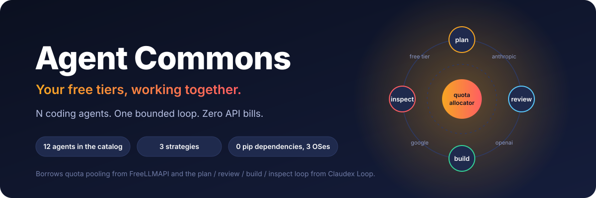
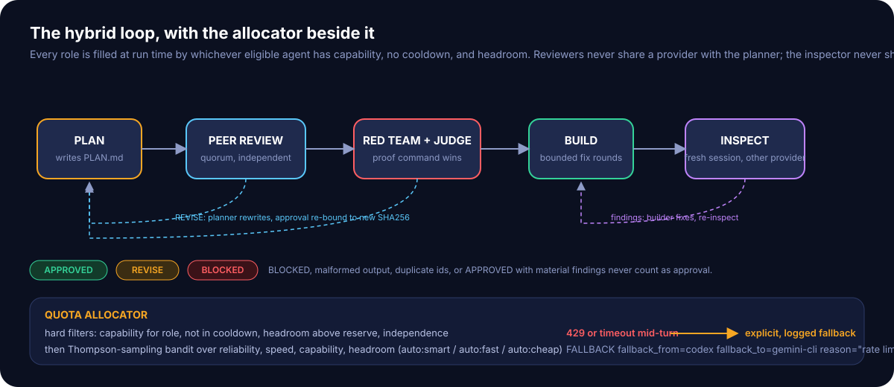
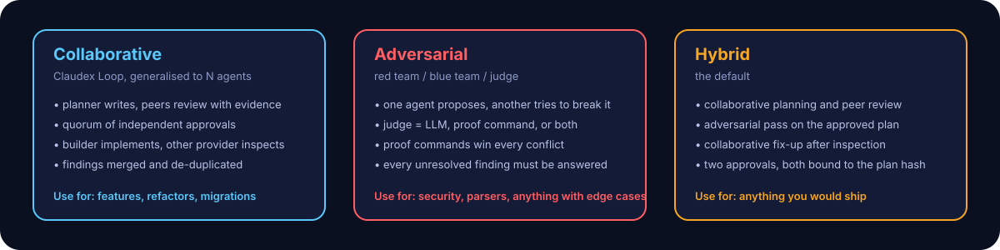
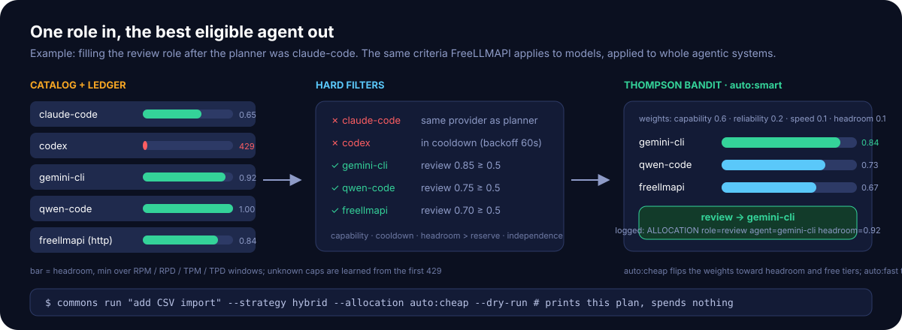

<div align="center">



### Where free agents argue until the code is right.

N coding agents. One bounded loop. Zero API bills.

[](https://github.com/dgiunchi/agora/actions/workflows/ci.yml)
[](./LICENSE)
[](./pyproject.toml)
[](./pyproject.toml)
[](#contributing)

**Claude Code, Codex, Gemini CLI, Aider, OpenCode, Qwen Code and friends plan, review, build and inspect each other's work, while a quota allocator spends only the free tiers and subscriptions you already have.**

</div>

---

## Contents

- [Why this exists](#why-this-exists)
- [What you get in 20 seconds](#what-you-get-in-20-seconds)
- [Supported agents](#supported-agents)
- [Quick start](#quick-start)
- [Strategies](#strategies)
- [Allocation](#allocation)
- [What an approval means](#what-an-approval-means)
- [Tests](#tests)
- [Limitations and terms of service](#limitations-and-terms-of-service)
- [Contributing](#contributing)
- [Credits](#credits)

## Why this exists

**Free tiers are toys on their own.** Every vendor now ships a coding agent with a free or subscription quota: a few hundred requests per five hours here, a thousand per day there. [FreeLLMAPI](https://github.com/tashfeenahmed/freellmapi) showed that stacking the free *model* tiers of 34 providers adds up to real capacity, if a router tracks every cap and fails over the moment one is hit.

**Single-agent loops have blind spots.** A model reviewing its own plan tends to approve it. [Claudex Loop](https://github.com/chaseai-yt/claudex-loop) showed that handing the plan to a *different* provider for review, and the code to a fresh session of yet another provider for inspection, catches what one model misses. But it runs on exactly two providers and stops dead when one runs out of quota.

**Agora does both.** It treats whole agentic systems the way FreeLLMAPI treats models: a catalog with quota shapes, a persistent ledger of what each one has used, cooldowns on 429s, and a bandit that picks the best eligible agent for every role. Then it runs them through a Claudex-style bounded loop under a strategy you choose: collaborative, adversarial, or hybrid. When an agent is rate-limited mid-turn, the loop does not die and does not silently swap models either. It fails over to the next eligible agent and writes that down.

## What you get in 20 seconds



```text
$ agora run "add CSV import with validation" --strategy hybrid --allocation auto:cheap --proof-cmd pytest -q

- [2026-10-29T14:02:11Z] ALLOCATION role=plan agent=gemini-cli provider=google headroom=0.92 reason=auto:cheap bandit: ...
- [2026-10-29T14:03:40Z] REVIEW mode=collaborative round=1 agent=claude-code verdict=REVISE findings=3 material=2
- [2026-10-29T14:05:02Z] REVISION round=1 agent=gemini-cli plan_sha256=9f1c... addressed=2
- [2026-10-29T14:06:30Z] REVIEW mode=collaborative round=2 agent=claude-code verdict=APPROVED findings=1 material=0
- [2026-10-29T14:06:30Z] APPROVAL mode=collaborative round=2 agent=claude-code plan_sha256=4a77...
- [2026-10-29T14:08:12Z] TURN role=review agent=codex ok=false rate_limited=true
- [2026-10-29T14:08:12Z] FALLBACK role=review fallback_from=codex fallback_to=qwen-code reason=rate limited
- [2026-10-29T14:10:45Z] JUDGE by=proof-cmd round=1 passed=true
- [2026-10-29T14:10:45Z] APPROVAL mode=adversarial round=1 agent=qwen-code plan_sha256=4a77...
- [2026-10-29T14:18:03Z] BUILD agent=claude-code pre_build_commit=e3b0c4...
- [2026-10-29T14:18:40Z] PROOF cmd=["pytest","-q"] passed=true exit_code=0
- [2026-10-29T14:21:17Z] INSPECT round=1 agent=gemini-cli verdict=APPROVED findings=1 material=0 fingerprint=71ab...
- [2026-10-29T14:21:17Z] QUOTA agent=claude-code requests=3 failures=0 headroom=0.61 cooldown_s=0
- [2026-10-29T14:21:17Z] SUMMARY status=completed rounds=3 inspections=1 fallbacks=1 open_findings=1
```

Every line above is appended to `AGORA-LOG.md` in the target repository. The plan lives in `PLAN.md`. Per-turn diagnostics (prompt, exact argv, stdout, stderr, result) go to a directory *outside* the checkout.

## Supported agents

Any CLI with a headless mode, plus any OpenAI-compatible HTTP endpoint. The example catalog ships these:

<div align="center">
<table>
<tr>
<td align="center" width="140"><br/><b>Claude Code</b><br/><sub>subscription</sub></td>
<td align="center" width="140"><br/><b>Codex CLI</b><br/><sub>subscription</sub></td>
<td align="center" width="140"><br/><b>Gemini CLI</b><br/><sub>free</sub></td>
<td align="center" width="140"><br/><b>Qwen Code</b><br/><sub>free</sub></td>
<td align="center" width="140"><br/><b>OpenCode</b><br/><sub>free</sub></td>
</tr>
<tr>
<td align="center"><br/><b>Aider</b><br/><sub>free</sub></td>
<td align="center"><br/><b>Goose</b><br/><sub>free</sub></td>
<td align="center"><br/><b>Crush</b><br/><sub>free</sub></td>
<td align="center"><br/><b>Kilo Code</b><br/><sub>free</sub></td>
<td align="center"><br/><b>Cline CLI</b><br/><sub>free</sub></td>
</tr>
</table>

<i>plus <b>FreeLLMAPI</b> (34 providers, 635 free endpoints, one URL) and a local <b>Ollama</b> as HTTP tiers</i>

</div>

| Agent | Kind | Status | Notes |
|---|---|---|---|
| Claude Code, Codex CLI | cli | **doctor-verified** (installed, authenticated, version probed; see `VALIDATION.md`) | read-only review flags mirror Claudex Loop (`--safe-mode`, `exec -s read-only`) |
| Gemini CLI, Qwen Code, OpenCode, Aider, Goose, Crush, Kilo Code, Cline | cli | declared | headless argv from each tool's docs; send a PR with a `VALIDATION.md` entry once you have run one |
| FreeLLMAPI, Ollama, vLLM, LM Studio | http | **tested** (fake server in CI) | any `/v1/chat/completions` endpoint |

Adding an agent is one TOML table. See [`agents.example.toml`](agents.example.toml).

## Quick start

```bash
pipx install git+https://github.com/dgiunchi/agora        # or: pip install .
cp agents.example.toml agents.toml                                 # keep the agents you actually have
agora agents doctor                                              # installed? authenticated? version?
agora quota                                                      # what has each agent used, what is left
agora run "add CSV import" --strategy hybrid --dry-run           # who fills which role, spends nothing
agora run "add CSV import" --strategy hybrid --proof-cmd pytest  # the real thing
```

Requirements: Python 3.11+, git, and at least two agents from different providers (the loop refuses to let a provider review itself). No pip dependencies at runtime.

## Strategies



| Strategy | Shape | When |
|---|---|---|
| `collaborative` | plan → peer review (quorum) → build → independent inspect | features, refactors, migrations |
| `adversarial` | plan → red team + judge → build → red-team inspect | parsers, security, anything with nasty edge cases |
| `hybrid` (default) | plan → peer review → red team + judge → build → inspect | anything you would ship |

Tunables: `--rounds` (plan-review cap, default 5), `--quorum` (independent approvals needed), `--judge llm|proof-cmd|both` (proof commands win on conflict), `--max-fix-rounds`, `--max-inspection-rounds`, `--builder <id>`, `--no-fallback`.

## Allocation



The allocator never spends quota and never bends a hard rule:

1. **Hard filters**: capability for the role above threshold, not in cooldown, headroom above the reserve, and independence (a reviewer cannot share a provider with the planner; an inspector cannot share one with the builder).
2. **Thompson-sampling bandit** over reliability (observed successes and failures), speed (observed latency), capability (catalog prior) and headroom (the ledger's min over every RPM / RPD / TPM / TPD window). `auto:smart` weights capability, `auto:fast` weights speed, `auto:cheap` weights headroom and free tiers. `profile:<name>` walks a declared order.
3. **Explicit fallback**: a 429, a timeout or a crash mid-turn moves to the next eligible agent *only* for roles where you allow it, and the log records `fallback_from`, `fallback_to` and the reason. Claudex Loop's "no silent fallback" rule stays intact; FreeLLMAPI's fail-over becomes a visible event.

The ledger is SQLite. Unknown caps start optimistic and are learned from the first rate limit; declared caps always win. Windows reset at UTC midnight or roll, per agent.

## What an approval means

- An approval is bound to the plan path **and** its SHA256. Change one byte and the loop refuses to build.
- An inspection records the pre-build commit and a fingerprint of the working tree including untracked files. Later edits need another inspection.
- Reviewers and inspectors run read-only. Builders get bounded write permission.
- `BLOCKED`, malformed output, duplicate finding ids, `APPROVED` with high or medium findings, an exhausted round budget, or a rate-limited reviewer with fallback disabled are all surfaced. None of them is ever converted into approval.
- Zero findings is a valid outcome. A pile of findings is not a quality score. A quorum is evidence, not truth.

## Tests

Everything runs on **fake agent processes** and disposable git repositories. The default suite spends no quota and needs no credentials.

```text
python scripts/validate.py agents.example.toml
python -m unittest discover -s tests -t . -v
```

| Group | What it proves |
|---|---|
| ledger | windows roll, UTC-midnight and rolling resets, cooldown backoff and cap, caps learned from a 429, headroom math, persistence |
| allocator | hard filters hold across 1,000 randomised draws, `auto:cheap` prefers free tiers, seeded bandit is deterministic, dry-run spends nothing, independence via role references |
| review | schema validation: duplicate ids, bad severity, APPROVED with material findings, missing coverage, JSON wrapped in prose or in `claude -p` output |
| runner | five artifact files, stderr preserved, timeout kills the process tree, rate-limit detection, Windows Node launch path, HTTP agents including 429 |
| approval | one byte invalidates an approval, untracked files change the inspection fingerprint |
| strategies | all three reach a terminal state inside the round cap; BLOCKED, malformed, duplicate ids and APPROVED-with-material are rejected; quorum; judge rules; tampered plan refused; fix rounds |
| fallback | logged with `fallback_from`, `fallback_to`, `reason`; disabled per role fails loudly; independence survives fallback; budget |
| end to end | three fake agents, a toy repo, a real proof command, all three strategies, log and per-agent quota asserted |

CI runs the suite on Ubuntu, Windows and macOS with Python 3.11 and 3.13, then installs the package and smokes the CLI. Live runs against real CLIs are opt-in and recorded in [`VALIDATION.md`](VALIDATION.md).

## Limitations and terms of service

- No frontier guarantee: the agent that has quota left late in the day may not be the smartest one. The log always says who did what.
- Independence is by provider, not by model family. Two agents backed by the same upstream model are not independent even if their providers differ.
- Use only quotas you are entitled to. Several vendors forbid proxying or resale of free tiers; FreeLLMAPI's architecture docs keep an honest per-provider table. Agora never shares a credential between agents and never routes one agent's traffic through another's account.
- The loop needs headless CLIs. Editor-only agents (Cursor, Cline VS Code, Roo Code, Continue, Zed, JetBrains AI) are not in the catalog until they expose one.
- This is not a chat proxy. Point raw clients at FreeLLMAPI instead and list it here as an HTTP tier.

## Contributing

Good first PRs:

- **Validate an agent** you have installed: run `agora agents doctor`, then a `--dry-run` and one real loop, and add a row to `VALIDATION.md`.
- **Add an agent**: one `[[agents]]` table in `agents.example.toml` with its headless argv and documented quota, plus a test in `tests/test_validate_and_cli.py` if it needs special parsing.
- **Improve the bandit**: latency-weighted priors, per-role reliability, regional pinning.
- **Strategy ideas**: tournament (N proposals, one judge), debate with a moderator, mixed authorship with cross-inspection.

Run the suite before opening a PR. See [CONTRIBUTING.md](CONTRIBUTING.md).

## Credits

- [FreeLLMAPI](https://github.com/tashfeenahmed/freellmapi) (MIT) for the quota ledger, the bandit scoring, the fallback chain and the agent logos in `assets/agents/`.
- [Claudex Loop](https://github.com/chaseai-yt/claudex-loop) (MIT) by Chase AI for the plan / review / build / inspect loop, the structured verdict contract, SHA-bound approvals, fake-CLI testing and the read-only reviewer flags. Claudex Loop itself credits [Matt Pocock](https://github.com/mattpocock/skills) and [Peter Steinberger](https://github.com/steipete/agent-scripts).

MIT licensed. Agent logos belong to their respective projects.