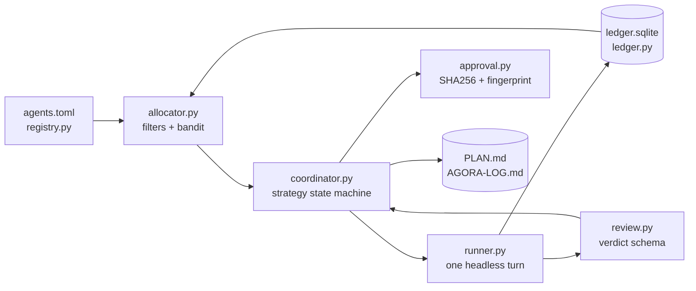

# Architecture

Agora is six small modules and one coordinator, all standard library.



## Components

| Module | Responsibility | Borrowed from |
|---|---|---|
| `registry.py` | Load and validate the TOML catalog of agentic systems: invocation, quota windows, capability priors, trust class | FreeLLMAPI provider catalog |
| `ledger.py` | SQLite counters per `(agent, model, key, window)`, cooldown with exponential backoff, caps learned from 429s, headroom | FreeLLMAPI rate-limit ledger |
| `allocator.py` | Hard filters then Thompson-sampling bandit; `auto:smart`, `auto:fast`, `auto:cheap`, named profiles; explicit `next_choice` for fallback; `plan()` for dry runs | FreeLLMAPI routing strategies |
| `runner.py` | One CLI or HTTP turn: argv lists, artifact directory, timeout with process-tree kill, rate-limit detection, Windows Node launch | Claudex Loop runner |
| `review.py` | The structured verdict contract and its validation rules | Claudex Loop structured review |
| `approval.py` | Approval bound to plan SHA256; inspection fingerprint over tracked diff plus untracked files | Claudex Loop approval binding |
| `coordinator.py` | Strategy state machines, explicit fallback, append-only log, proof commands, judge rules | Claudex Loop phases, generalised |

## The allocation algorithm

Given a `RoleRequest(role, independent_of, exclude, min_capability)`:

1. For every agent in the pool (the whole catalog, or a named profile's list):
   - reject if excluded or if it *is* one of the agents it must be independent of;
   - reject if its trust class is `independent` and its provider matches the provider of any agent in `independent_of`;
   - reject if `capability[role] < min_capability`;
   - reject if the ledger says it is in cooldown;
   - reject if `headroom <= reserve` (default 0.05).
2. For each survivor compute four terms in `[0, 1]`:
   - **reliability**: a Beta(successes + 1, failures + 1) sample from the ledger's invocation history (Thompson sampling);
   - **speed**: `1 / (1 + avg_latency / 30s)` from observed successful turns, or 0.5 prior;
   - **capability**: the catalog prior for the role;
   - **headroom**: the ledger's minimum over every window of `(cap - used) / cap`; under `auto:cheap` this is averaged with a tier bonus (free 1.0, subscription 0.5, paid 0.0).
3. Score = weighted sum using the strategy's weights. Highest wins. A named profile skips scoring and takes the first survivor in declared order.
4. The chosen `Allocation` carries the reason string that is written to the log.

The allocator reads the ledger and never writes it. Only the runner's result, recorded by the coordinator, moves counters.

## Headroom and learned caps

Each agent declares windows such as `minute = 60s`, `5h = 18000s`, `day = 86400s`, with optional request and token caps. Buckets are aligned to UTC midnight (`reset = "utc-midnight"`) or to the epoch (`reset = "rolling"`), so no history scan is needed and resets are deterministic.

Unknown caps are optimistic (headroom 1.0). On the first rate limit the ledger records the usage in each window as the learned cap, which makes headroom 0 for the rest of that window and informative afterwards. Declared caps always override learned ones.

Cooldown delay is `base * 2^(failures - 1)` capped at `max_cooldown`; a successful turn clears it.

## Strategies as state machines

```text
collaborative:  PLAN -> REVIEW(collab, quorum) -> BUILD -> INSPECT(collab)
adversarial:    PLAN -> REVIEW(red team + judge) -> BUILD -> INSPECT(red team)
hybrid:         PLAN -> REVIEW(collab) -> REVIEW(red team + judge) -> BUILD -> INSPECT(collab)
```

A review phase loops up to `rounds` times. In collaborative mode every reviewer in the quorum must return `APPROVED`. In adversarial mode the red team's material findings go to the judge: with `proof-cmd` a passing proof clears everything; with `llm` an independent judge agent names the ids that still stand; with `both` the LLM judge is consulted but a failing proof means nothing clears. The judge must be independent of both the planner and the red team, so it needs a third provider. With `both` (the default) and only two providers the judge step is skipped and logged as `JUDGE by=llm skipped=true`; nothing is cleared, so every material finding goes back to the planner. With `llm` the loop fails instead, because an LLM judge was asked for explicitly. `agora run --dry-run` shows the same decision as a note. Whatever is left goes back to the planner as a revision, which rewrites `PLAN.md` and voids any earlier approval.

Role-dependent flags come from the catalog: `read_only_argv` is appended for planners, reviewers, inspectors and judges; `write_argv` only for builders (Codex: `-s read-only` versus `-s workspace-write`, as in Claudex Loop). The two are never combined on one command line.

## Trust boundaries

Flags are a request to the CLI, not a guarantee, so the coordinator verifies:

- **Every turn is bracketed by a working-tree fingerprint.** A read-only turn (plan, review, judge, inspect) that changes the tree fails with `read-only turn changed the working tree`, is logged `TURN ... read_only=true tree_changed=true ok=false`, falls back like any failed turn, and makes that agent an *author*. A failed write turn that changed the tree does the same. Inspectors must be independent of every author, not only of the recorded builder. Interpreter and test caches (`__pycache__`, `.pytest_cache`, `node_modules`, ...) are ignored by the fingerprint so that running the proof command is not a change.
- **The approved plan is the contract.** `check_approval` runs before the build (as before) and again after every build and fix turn and before every inspection. A builder that rewrites `PLAN.md` ends the run with `PLAN_TAMPERED` and `failed`.
- **Plan authors never review.** The planner and every reviser are recorded; reviewers and the judge must be independent of all of them. Quorum peers must also be independent of each other, so a quorum is always distinct providers. In `hybrid`, if the red team forces a revision after the peers approved, the peers review the revised plan once more (`REREVIEW`).
- **Log lines cannot be forged.** Agent text that reaches the log (errors, evidence) has control characters stripped, so a reply containing a newline and `- [ts] APPROVAL ...` stays on one line.
- **Prompts never meet a shell.** argv is always a list. On Windows, `shutil.which` resolves the executable exactly as `doctor` does; an npm `.cmd` shim is read and replaced by `node <entry.js>` (or the `.exe` it wraps), and any other `.cmd`/`.bat` is refused with a message naming `node_entry`, the catalog field that pins the entry file explicitly.
- **Nothing runs on after Ctrl-C.** A turn interrupted for any reason kills the agent's process tree (SIGTERM then SIGKILL on POSIX, `taskkill /T` on Windows). The proof command gets the same treatment on timeout.
- **A missing proof command is visible.** `PROOF skipped=true` is logged, `--dry-run` says so, and the CLI prints a warning at the end.

## Catalog extras

- `[profiles]` is an optional table: `coding = ["codex", "claude-code"]`. `--allocation profile:coding` takes the first eligible agent in that order and skips the bandit. An unknown profile name or an unknown agent id is a catalog error.
- CLI agents whose executable cannot be found are rejected by the allocator with `executable not found`, in dry runs too; `--assume-installed` disables this for planning on a machine without the tools.
- Artifacts (prompt, exact argv and the resolved launch command, stdout, stderr, result) default to `~/.agora/artifacts`, created with mode 0700, or `--artifacts DIR`.
- `rolling` windows are epoch-aligned buckets (a 5-hour window resets every five hours from the epoch), not sliding windows from first use. They are deterministic and need no history scan; a burst that straddles a boundary is undercounted.

`BUILD` refuses to start unless the current plan bytes match the approval. It records the pre-build commit, lets the builder work, then runs the proof command with up to `max_fix_rounds` builder fixes. `INSPECT` runs in a fresh session of a provider that did not build, records a fingerprint of the working tree, and loops up to `max_inspection_rounds` with builder fixes in between.

## Explicit fallback

`Coordinator._turn` wraps every agent call. If the turn is not `ok` (rate limit, timeout, crash, non-zero exit), the coordinator checks whether the role is in `fallback_roles` and the per-turn budget is not spent, asks the allocator for `next_choice`, logs a `FALLBACK` line with `fallback_from`, `fallback_to` and `reason`, and retries with the new agent under the same independence constraints. If fallback is not allowed the loop fails with that reason. Nothing is swapped silently.

A failed write turn is not necessarily a no-op: a timeout kills the process, not the edits it already made. Before and after every write turn the coordinator takes the working-tree fingerprint; if a failed attempt changed it, that agent is recorded as an author (`FALLBACK ... tree_changed=true`), the `INSPECT` line lists it under `also_touched`, and the inspector must be independent of every author, not only of the builder that finally succeeded. With two providers this can end the loop with no eligible inspector, which is the correct outcome: nobody independent is left to inspect.

## Diagnostics

Each turn gets a directory under the system temp directory (or `--artifacts`) containing `prompt.txt`, `command.json` (exact argv, cwd, timeout, requested model), `stdout.txt`, `stderr.txt` and `result.json`. These may contain private code and are never written into the target checkout.